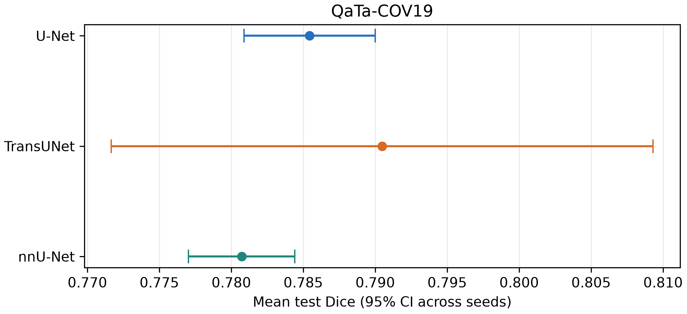
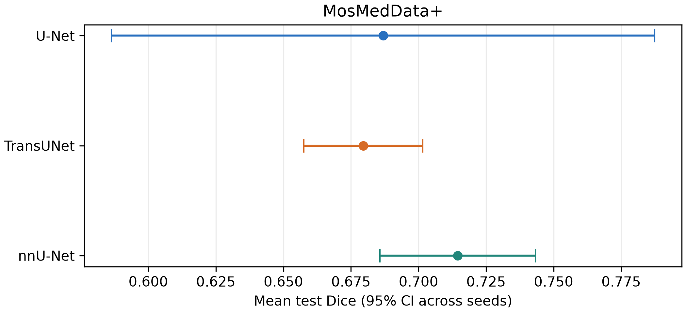
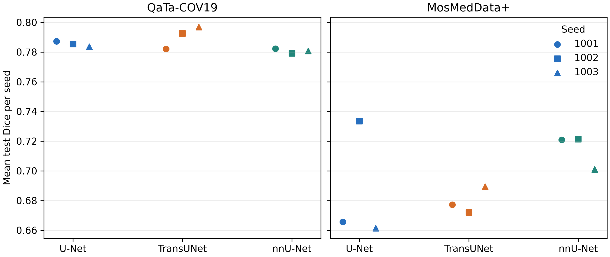

# Phase 0 — Image-Only Segmentation Results

## Task 0.6 — Summarize the Results

### Evaluation setup

U-Net, TransUNet, and nnU-Net were evaluated on the fixed LViT test splits of QaTa-COV19 (2,113 images) and MosMedData+ (273 images). Each model was evaluated with three training seeds (1001, 1002, and 1003), for a total of 18 runs. Checkpoints were selected using validation Dice. The test evaluator used a resolution of 224 × 224 and a foreground probability threshold of 0.5.

For each run, metrics were averaged across test images. The table reports the mean ± sample standard deviation of these run-level averages across the three seeds. Dice 95% confidence intervals were computed using a two-sided Student's t interval on the three seed-level means (df = 2).

Foreground mIoU is the mean lesion IoU across test images, with the background class excluded. HD95 and ASSD are measured in pixels at the evaluation resolution. When both masks were empty, Dice and IoU were set to 1 and both distance metrics to 0. When exactly one mask was empty, Dice and IoU were set to 0 and both distance metrics received a penalty of 315.37 pixels, the distance between opposite corner pixels.

### Main results

Bold values indicate the best mean for each metric within each dataset.

| Dataset | Method | Dice Mean ± SD ↑ | Dice 95% CI | Foreground mIoU ↑ | HD95 ↓ (px) | ASSD ↓ (px) |
|---|---|---:|---:|---:|---:|---:|
| QaTa-COV19 | U-Net | 0.7854 ± 0.0018 | [0.7809, 0.7900] | 0.6906 ± 0.0025 | 31.96 ± 0.55 | 11.21 ± 1.16 |
| QaTa-COV19 | TransUNet | **0.7905 ± 0.0076** | [0.7717, 0.8093] | **0.6974 ± 0.0081** | **30.28 ± 0.37** | 10.32 ± 1.28 |
| QaTa-COV19 | nnU-Net | 0.7807 ± 0.0015 | [0.7770, 0.7844] | 0.6839 ± 0.0018 | 32.21 ± 0.43 | **9.86 ± 0.69** |
| MosMedData+ | U-Net | 0.6869 ± 0.0405 | [0.5863, 0.7874] | 0.5569 ± 0.0394 | 30.12 ± 6.20 | 14.56 ± 6.15 |
| MosMedData+ | TransUNet | 0.6795 ± 0.0089 | [0.6575, 0.7016] | 0.5461 ± 0.0139 | 27.00 ± 1.29 | 12.56 ± 3.16 |
| MosMedData+ | nnU-Net | **0.7145 ± 0.0116** | [0.6857, 0.7433] | **0.5850 ± 0.0100** | **22.29 ± 1.61** | **8.12 ± 1.92** |

### Observations

- **QaTa-COV19.** TransUNet had the highest mean Dice and foreground mIoU and the lowest mean HD95. Its mean Dice was 0.0050 higher than U-Net's, a difference of 0.50 percentage points. nnU-Net had the lowest mean ASSD.
- **MosMedData+.** nnU-Net led on all four mean metrics. Its mean Dice was 0.0276 higher than U-Net's and 0.0349 higher than TransUNet's. U-Net had the largest Dice variation across seeds on this dataset (SD = 0.0405).

## Task 0.7 — Pairwise Dice Comparisons

For each model, Dice scores were averaged across the three seeds for each test image. Models were paired by `sample_id`. The reported difference (ΔDice) is the mean per-image Dice for model A minus that for model B. QaTa-COV19 inference treated 2,113 images as independent units. MosMedData+ standard errors accounted for clustering of 273 slices within 9 scans, with scan IDs inferred from the sample filenames. The point estimates remained weighted equally by image.

The 95% confidence intervals are unadjusted. Two-sided p-values were adjusted using Holm's method across the three comparisons within each dataset.

| Dataset | Method A | Method B | ΔDice (A − B) | Unadjusted 95% CI | Raw p | Holm p |
|---|---|---|---:|---|---:|---:|
| QaTa-COV19 | U-Net | TransUNet | −0.0050 | [−0.0090, −0.0010] | 0.013449 | 0.0269 |
| QaTa-COV19 | U-Net | nnU-Net | +0.0047 | [+0.0009, +0.0086] | 0.016502 | 0.0269 |
| QaTa-COV19 | TransUNet | nnU-Net | +0.0098 | [+0.0058, +0.0137] | 1.3581e-06 | 4.074 × 10⁻⁶ |
| MosMedData+ | U-Net | TransUNet | +0.0073 | [−0.0478, +0.0625] | 0.76731 | 0.8368 |
| MosMedData+ | U-Net | nnU-Net | −0.0276 | [−0.1022, +0.0470] | 0.41839 | 0.8368 |
| MosMedData+ | TransUNet | nnU-Net | −0.0349 | [−0.0665, −0.0034] | 0.034094 | 0.1023 |

On QaTa-COV19, all three pairwise differences were statistically significant after Holm adjustment at α = 0.05. TransUNet had the highest mean Dice, followed by U-Net and nnU-Net. The absolute differences ranged from 0.47 to 0.98 percentage points.

On MosMedData+, nnU-Net had the highest observed mean Dice. No pairwise comparison reached statistical significance after Holm adjustment. For TransUNet versus nnU-Net, the unadjusted interval excluded zero, while the Holm-adjusted p-value was 0.1023. Inference on this dataset was based on nine scan clusters.

The full-precision results are available in `results/phase0_pairwise_comparisons.csv`.

## Result files

- Main results: `results/phase0_main_results.csv`
- Run-level summaries, per-case metrics, and predicted masks: `results/phase0_evaluation/`

## Required Figures

